# TP 4 : Chat client/serveur avec UDP

**Matière :** Développement d'applications réparties
**Niveau :** LSI 3, Faculté des Sciences de Sfax
**Année universitaire :** 2026 – 2027

**Étudiant(e) :** islem henteti

---

## Objectif

Développer en Java une application de chat client/serveur en mode non-connecté, avec le protocole UDP (`DatagramSocket` et `DatagramPacket`). Les clients envoient et reçoivent des messages de manière asynchrone.

## Environnement

- JDK 1.8
- IntelliJ IDEA
- Git / GitHub

## Structure du projet

```
tp4/
├── src/
│   ├── serveur/
│   │   ├── ServeurUDP.java     (étape 2 : réception et affichage)
│   │   └── ServeurChat.java    (étape 3 : diffusion à plusieurs clients)
│   └── client/
│       ├── ClientUDP.java      (étape 2 : envoi seulement)
│       └── ClientChat.java     (étape 3 : envoi et réception)
├── image/                     (captures d'écran)
├── README.md
└── .gitignore
```

## Compilation et exécution

Avec IntelliJ, lancez chaque classe avec la flèche verte. Pour avoir plusieurs clients, activez **Allow multiple instances** dans la configuration de `ClientChat`.

---

## Étape 2 : Chat unidirectionnel

### Principe

- Le **serveur** (`ServeurUDP`) crée un `DatagramSocket` non lié, puis le lie au port **1234** avec `InetSocketAddress`. Il attend les datagrammes avec `receive()` et affiche l'adresse (IP:port) de l'expéditeur et le message.
- Le **client** (`ClientUDP`) demande un nom d'utilisateur, puis envoie chaque message sous la forme `[NomUtilisateur] : message` dans un `DatagramPacket`.

**code du Serveur UDP**

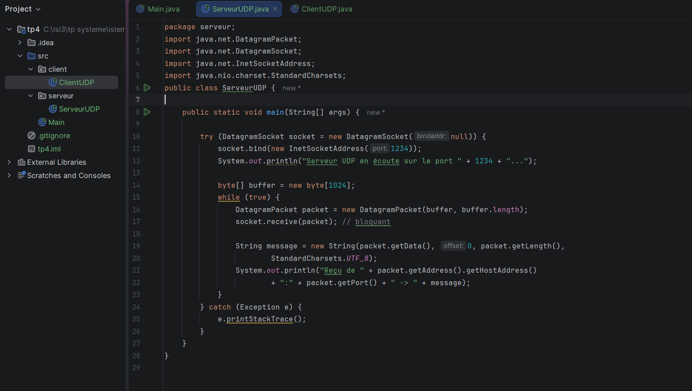

**code du Client UDP**

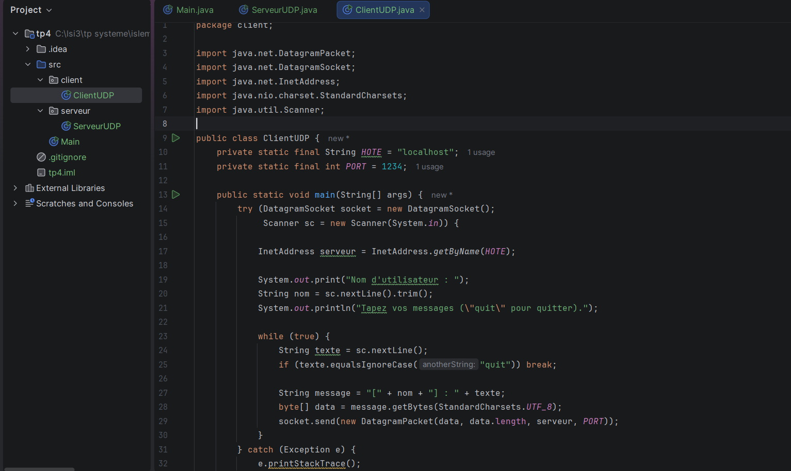


**Serveur UDP en écoute et messages reçus :**

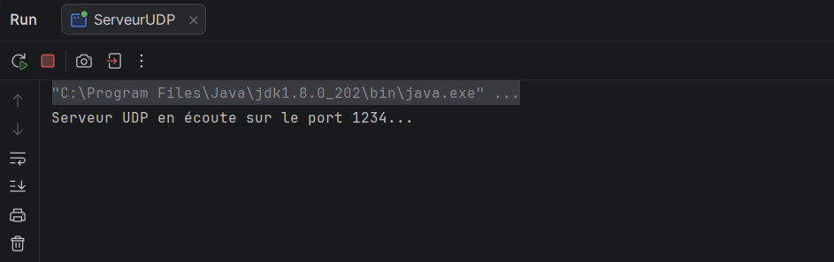

**Client UDP envoyant des messages :**

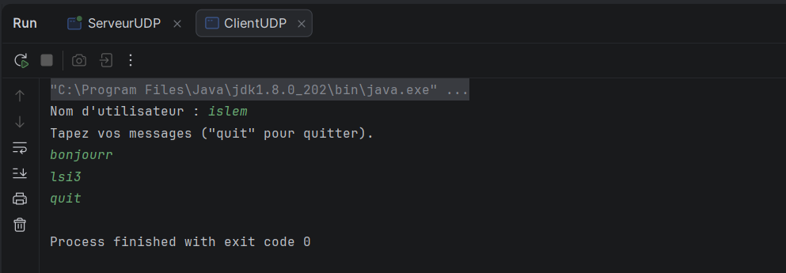

**resultat de serveur:**

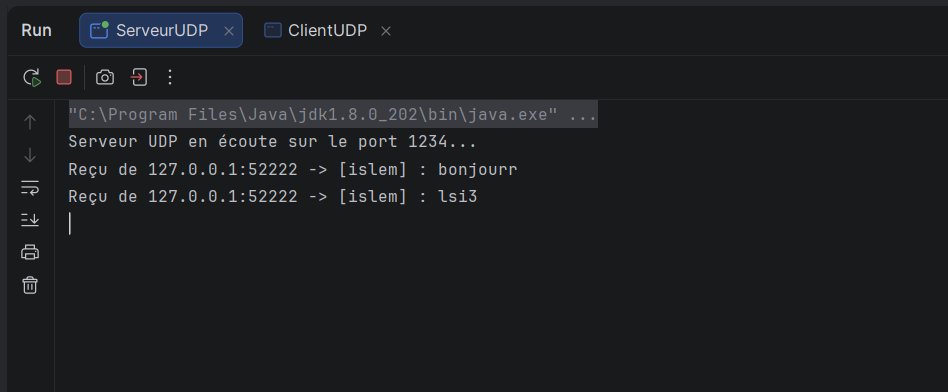

### Synthèse

UDP est un protocole non connecté : le client envoie ses datagrammes sans établir de connexion préalable avec le serveur. Le serveur reçoit les messages un par un et identifie l'expéditeur grâce à l'adresse IP et au port contenus dans chaque paquet. Cette étape montre le principe de base de l'échange de datagrammes, avec `send()` côté client et `receive()` côté serveur.

---

## Étape 3 : Chat bidirectionnel et diffusion

### Principe

- Le **serveur** (`ServeurChat`) garde dans un `Set<SocketAddress>` les adresses des clients qui ont envoyé un message. À chaque réception, il enregistre l'expéditeur s'il est nouveau, puis retransmet le message à tous les autres clients, sauf l'expéditeur.
- Le **client** (`ClientChat`) utilise deux threads : un thread dédié reçoit les messages en continu avec `receive()`, pendant que le thread principal lit le clavier et envoie. À la connexion, il envoie un message `*** Nom a rejoint le chat ***` pour que le serveur enregistre son adresse.


**code du Serveur de chat**

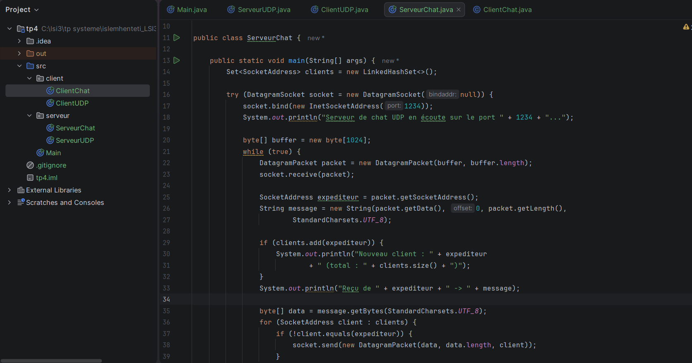

**code du client de chat**

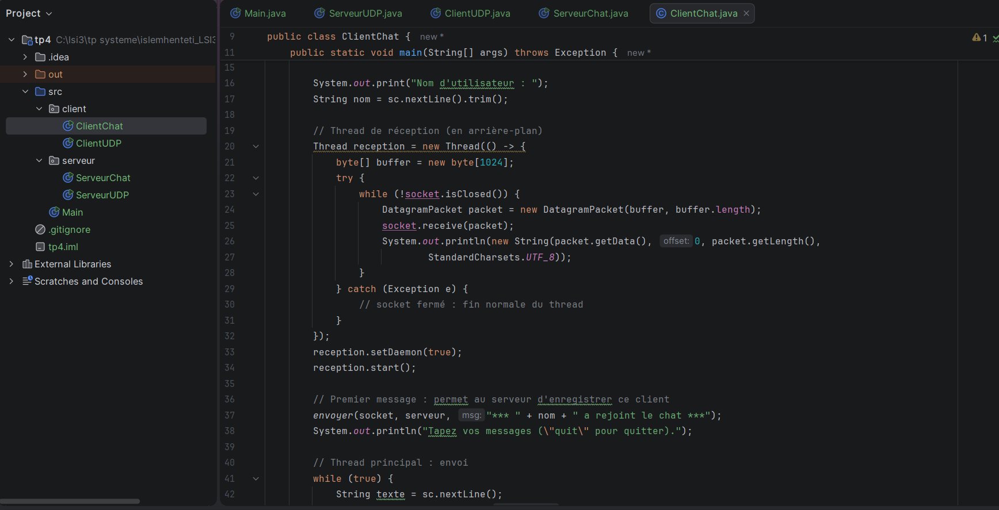

**Serveur de chat en attent :**

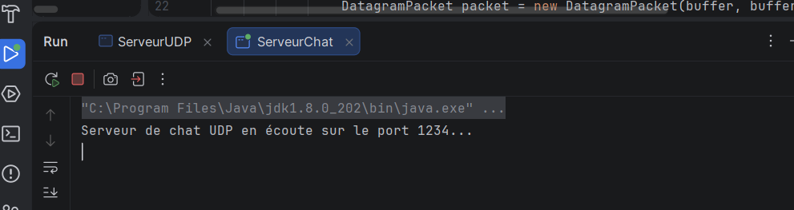

**Client 1 (islem) :**

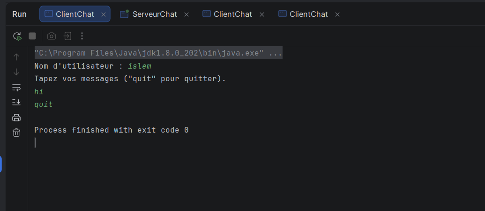

**Client 2 (hana) :**

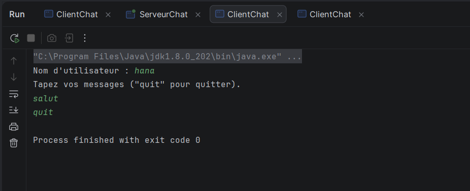

**Client 3 (ahmed) :**

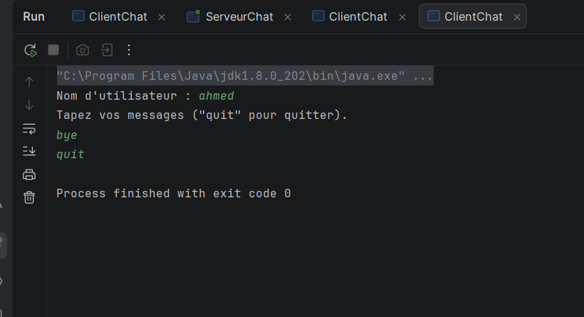

### Synthèse

Le serveur simule une « connexion » en mémorisant l'adresse de chaque client à son premier message. La diffusion se fait en parcourant la liste des clients et en envoyant un datagramme à chacun, sauf à l'expéditeur. Côté client, l'utilisation de threads permet d'envoyer et de recevoir en même temps, ce qui donne un échange en temps quasi réel entre plusieurs clients.

---

## Limites d'UDP observées

- Pas de garantie de livraison : un message peut être perdu.
- Pas de garantie d'ordre : les messages peuvent arriver dans un ordre différent.
- Pas de détection de déconnexion : un client qui quitte reste dans la liste du serveur.

## Conclusion

Ce TP a permis de maîtriser l'échange de datagrammes avec `DatagramSocket` et `DatagramPacket`, et de réaliser un chat multi-clients avec diffusion en mode non-connecté.